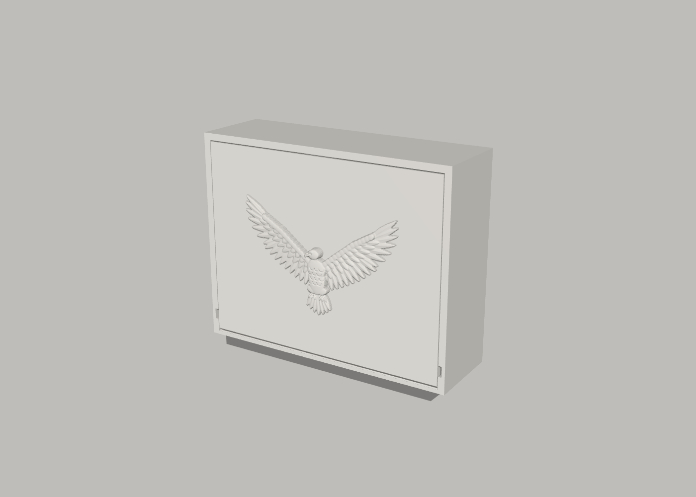
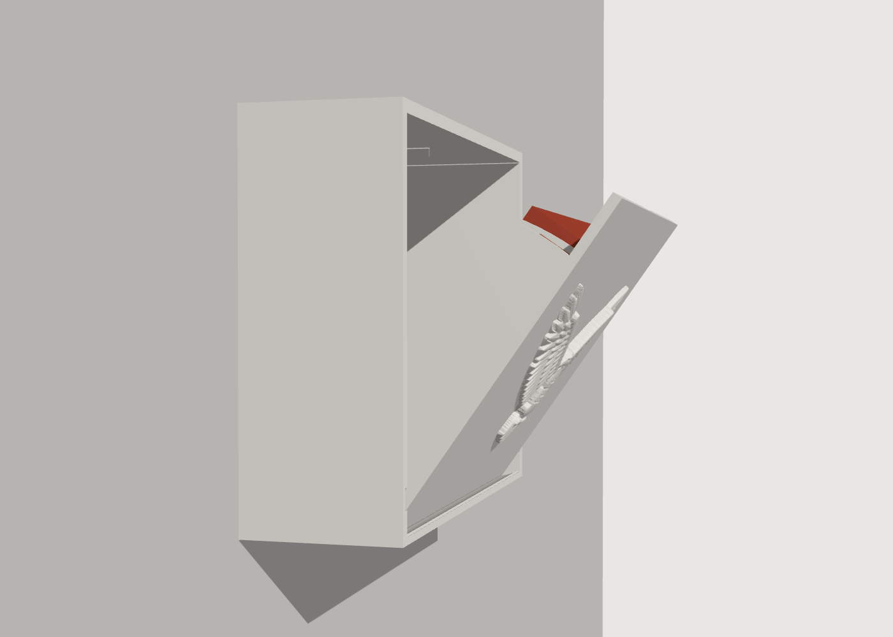
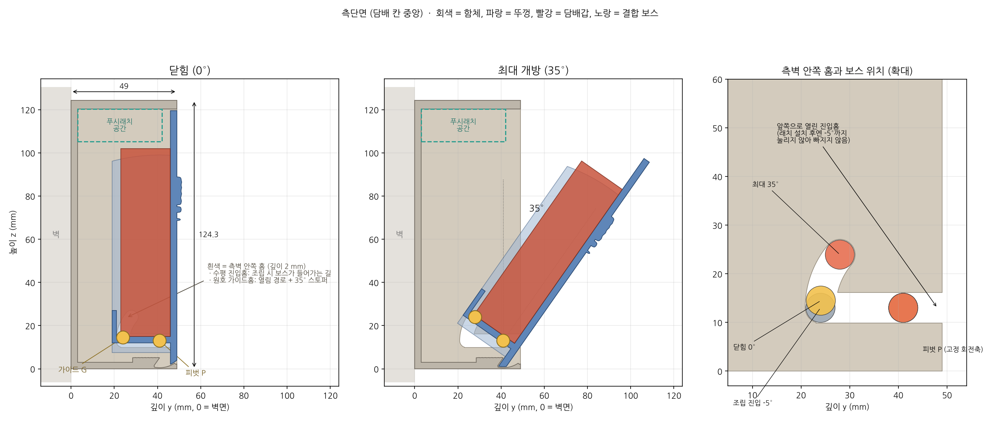

# 벽부형 담배 케이스 v2 (틸트아웃)

양면테이프로 벽에 붙이는 케이스입니다. 앞판을 누르면 푸시래치가 "달칵" 하고 풀리고, 뚜껑이 앞으로 **35°** 기울어집니다. 앞판 안쪽에 기대어 있던 담배갑 2개와 라이터가 뚜껑과 함께 앞으로 나옵니다.

| 닫힘 | 열림 (35°) | 측면 |
|---|---|---|
|  |  |  |



## 1. 주요 치수

| 항목 | 값 |
|---|---|
| 외형 W × H × D | **156.8 × 124.3 × 49 mm** |
| 담배 칸 | 113 × 25 mm (갑 55 × 87 × 23 mm 2개) |
| 라이터 칸 | 28 × 25 mm (25 × 15 × 82 mm까지) |
| 최대 개방각 | 35° (원호 가이드홈 끝에서 멈춤) |
| 개방 시 앞판 상단 돌출 | 약 61 mm |
| 개방 시 담배갑 노출 | 갑 뒷면 기준 위쪽 **49 mm** (전체 87 mm의 56 %) |
| 푸시래치 공간 | 39(깊이) × 27(폭) × 15(높이) mm, 앞판 뒷면까지 4 mm 여유 |

**개방각 35°를 고른 근거** (`check.py`로 계산)

| 개방각 | 담배갑 뒷면 노출 | 라이터 노출 |
|---|---|---|
| 20° | 15.7 mm | 33.0 mm |
| 25° | 31.0 mm | 43.3 mm |
| 30° | 41.5 mm | 50.3 mm |
| **35°** | **49.0 mm** | **55.6 mm** |

손가락 두 마디(약 40–50 mm)로 갑을 집을 수 있는 각도입니다. `model.py`의 `THETA_MAX` 값으로 조정할 수 있습니다.

## 2. 결합 구조 (외부에서 보이지 않음)

- **피벗 P**: 뚜껑 측면판 바깥쪽의 Ø6 보스입니다. 함체 측벽 안쪽 홈(깊이 2 mm)에 끼워지며 회전축이 됩니다.
- **가이드 G**: 피벗에서 17 mm 떨어진 Ø6 보스입니다. 원호 홈을 따라 움직이기 때문에 뚜껑은 정해진 경로로만 열리고 닫힙니다.
  - 원호 끝(+35°)은 최대 개방 스토퍼입니다.
  - 반대쪽 끝(−5°)은 조립용 진입 위치입니다.
- **빠짐 방지**: 래치를 설치하면 뚜껑이 −2°(래치 누름 여유)까지만 들어갑니다. 진입 위치(−5°)에 도달할 수 없으므로 사용 중에는 뚜껑이 빠지지 않습니다.
- 정면에서는 측벽 아래쪽 앞 모서리에 진입홈 입구(6.3 × 2 mm)만 작게 보입니다.

## 3. 출력 파일

| 파일 | 내용 | 출력 방향 (파일 그대로) | 서포트 |
|---|---|---|---|
| `stl/body.stl` | 함체 | 뒷판이 베드 | 불필요 |
| `stl/lid.stl` | 뚜껑 (앞판 + 측면판 + 바닥 + 칸막이) | 앞판 앞면이 베드 | 불필요 |
| `stl/eagle.stl` | 독수리 부조 | 뒷면이 베드 | 불필요 |


**권장 설정**: PETG, 0.2 mm 레이어(부조만 0.12 mm), 벽 4라인, 인필 20 %. 베드는 160 × 130 mm 이상이 필요합니다.

## 4. 부품

| 부품 | 규격 | 수량 |
|---|---|---|
| 푸시래치 | 몸체 39 × 27 × 15 mm 이하 (예: Sugatsune ML-30 급, 스트로크 8.5 mm) | 1 |
| 정렬 핀 | 1.75 mm 필라멘트 토막 4 mm | 2 |
| 접착제 | 독수리 부착용 (순간접착제 또는 에폭시) | 소량 |
| 양면 폼테이프 | 악어테이프 / VHB, 폭 20 mm | 약 50 cm |
| (선택) 접시머리 나사 | Ø4 | 2 |

> 래치 크기가 다르면 `LATCH_L / LATCH_W / LATCH_H / LATCH_FRONT_GAP`만 바꾸고 다시 생성하면 됩니다. 함체 높이와 깊이가 자동으로 다시 계산됩니다.

## 5. 조립 순서

1. **독수리 부착**: 앞판과 독수리 뒷면의 Ø2 구멍에 필라멘트 토막을 꽂아 위치를 맞추고 접착합니다.
2. **뚜껑 삽입** (래치를 달기 전에):
   1. 뚜껑 윗부분을 약간 뒤로 젖힌 자세(−5°)로 듭니다.
   2. 측면 보스 2쌍을 측벽 앞 모서리의 진입홈 입구에 맞추고 수평으로 끝까지 밀어 넣습니다.
   3. 앞판을 세우면 가이드 보스가 원호 홈으로 들어갑니다.
3. **푸시래치 설치**: 뚜껑을 35°까지 연 상태에서, 윗판 아래 가이드 리브 사이에 래치를 넣습니다. 래치 앞면이 앞판 뒷면에서 약 4 mm 떨어지도록 하고 나사 또는 양면테이프로 고정합니다. 앞판 뒷면 상단에는 스트라이크(철판) 자리(20 × 20 × 1 mm)가 있습니다.
4. **동작 확인**: 누르면 열리고 35°에서 멈춰야 합니다. 다시 밀어 닫으면 래치가 걸려야 합니다.

## 6. 벽 부착

- 3M VHB 기술자료의 정하중 기준은 **1 kg당 57 cm²**입니다.
- 총중량은 약 0.35 kg(케이스 약 0.25 kg + 내용물)이므로 최소 20 cm²가 필요합니다. **폭 20 mm × 130 mm 테이프 3줄(78 cm², 안전율 약 4배)**을 권장합니다.
- 벽은 IPA로 닦은 뒤 붙이고, 24시간 지나서 사용합니다.
- 진동이 있는 벽에는 래치 높이에 있는 나사 구멍 2개를 함께 사용합니다. 뚜껑을 연 상태에서 앞쪽으로 드라이버를 넣을 수 있습니다.

## 7. 재생성과 검증

```bash
pip install manifold3d trimesh numpy scipy matplotlib
python3 model.py   # STL 생성
python3 check.py   # 간섭·스토퍼·빠짐방지·조립경로 검증
python3 draw.py    # 측단면 설명도
```

`check.py`가 검증하는 항목:
- 회전 범위 −5° ~ 35° 전체에서 간섭 0 mm³
- ±1.5° 바깥에서 스토퍼가 걸림
- 사용 범위에서 앞으로 당기거나 들어 올려도 빠지지 않음
- 조립 경로에 걸림이 없음
- 내용물과 래치 공간이 서로 간섭하지 않음
