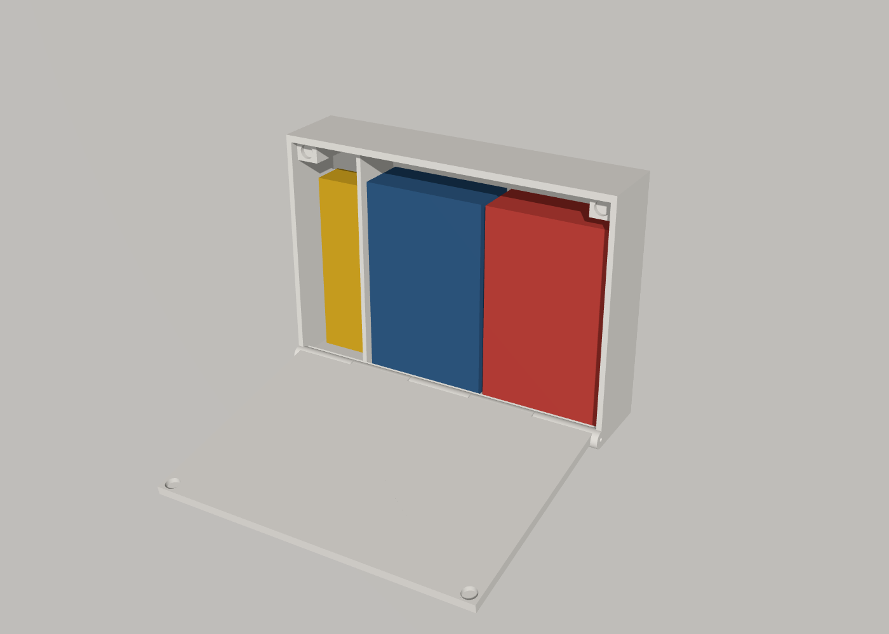
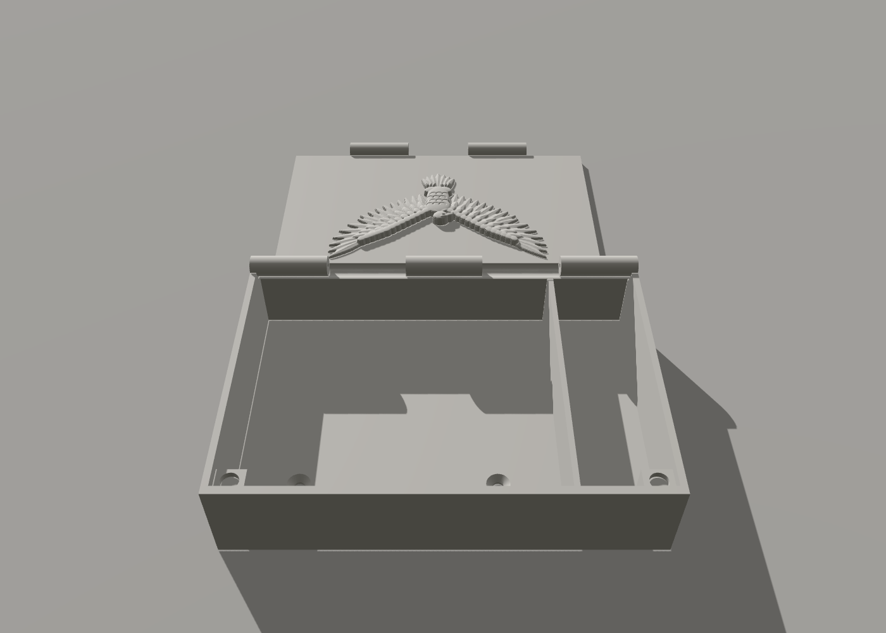

# 벽부형 담배 케이스 (담배갑 2 + 라이터 1)

양면테이프(악어테이프 등)로 벽에 붙이는 하단 힌지식 보관함입니다. 앞문에는 독수리 부조가 있습니다.




## 1. 치수 요약

| 항목 | regular (일반 갑) | universal (일반 + 슬림 갑) |
|---|---|---|
| 외형 W × H × D | 150.8 × 109 × 33 mm (힌지 포함 37) | 150.8 × 129 × 33 mm (힌지 포함 37) |
| 섹터1 (담배갑 2개) 내부 | 114 × 102 × 26 mm | 114 × 122 × 26 mm |
| 섹터2 (라이터) 내부 | 30 × 102 × 26 mm | 30 × 122 × 26 mm |
| 수용 기준 | 갑 55 × 23 × 88 mm × 2 | 갑 높이 108 mm까지 |
| 라이터 기준 | 25 × 15 × 82 mm (BIC J26 맥시급) | 동일 |

- 정면에서 볼 때 **왼쪽이 라이터 칸, 오른쪽이 담배 칸**입니다.
- 에쎄 등 슬림 갑은 실측 후 `model.py`의 `PRESETS` 값을 수정하는 것을 권장합니다.

## 2. 출력 파일

| 파일 | 내용 | 출력 방향 |
|---|---|---|
| `stl/body_regular.stl` / `stl/body_universal.stl` | 본체 | 뒷판이 베드에 닿게 (파일 그대로) |
| `stl/door_regular.stl` / `stl/door_universal.stl` | 앞문 + 독수리 부조 | 문 뒷면이 베드에 닿게 (파일 그대로) |



**권장 출력 설정 (FDM, 0.4 mm 노즐)**
- 재료: **PETG 권장**. PLA는 약 55 °C에서 변형될 수 있어, 여름철 공장 벽이나 열원 근처에는 적합하지 않습니다.
- 레이어 0.2 mm (부조 품질을 높이려면 문만 0.12 mm), 벽 4라인, 인필 15–20 %.
- 서포트 불필요 (힌지 아래 45° 보강, 자석 보스는 뒷판까지 이어진 기둥으로 설계).
- 예상 중량: 본체 약 90–130 g, 문 약 55–80 g (인필에 따라 달라짐).

## 3. 부품 목록

| 부품 | 규격 | 수량 |
|---|---|---|
| 힌지 핀 | 1.75 mm 필라멘트 토막, 약 152 mm (또는 Ø2 mm 금속봉) | 1 |
| 네오디뮴 자석 | Ø6 × 2 mm | 4 (본체 2, 문 2) |
| 순간접착제 | 자석 고정용 | 소량 |
| 양면 폼테이프 | 악어테이프 / 3M VHB 등 | 아래 참고 |
| (선택) 접시머리 나사 | M4 또는 Ø4 목·앵커 나사 | 2 |

## 4. 조립

1. **자석**: 본체 상단 모서리 보스 2곳과 문 뒷면 상단 2곳의 포켓(Ø6.3 × 2.2 mm)에 접착제로 붙입니다. **본체와 문 자석이 서로 당기는 극**인지 먼저 확인합니다.
2. **힌지**: 문 너클을 본체 너클 사이에 맞추고, 측면 구멍(Ø2.1 mm)으로 필라멘트를 끝까지 넣습니다. 양 끝은 라이터나 인두로 살짝 녹여 버섯 모양으로 만들거나 접착제로 고정합니다.
3. **동작 확인**: 문은 0–180° 범위에서 본체와 간섭이 없습니다 (10° 간격으로 겹침 부피 0 mm³ 확인). 열면 문이 아래로 늘어지고, 닫으면 자석에 붙습니다. 문을 열 때는 독수리 부조를 손잡이처럼 잡아당기면 됩니다.

## 5. 벽 부착

- 3M VHB 기술자료에는 정하중(static load) 설계 기준으로 **하중 1 kg당 테이프 57 cm²**가 제시되어 있습니다.
- 내용물을 포함한 총중량은 약 0.3 kg(케이스 약 0.2 kg + 담배 2갑 + 라이터)이므로 최소 약 17 cm²가 필요합니다. 안전율 3배 이상을 고려해 **폭 20 mm × 길이 130 mm 테이프 3–4줄(약 78–104 cm²)**을 권장합니다.
- 부착 전 벽면의 먼지와 유분을 IPA(이소프로필알코올)로 닦고, 10–30초간 강하게 눌러 줍니다. 접착력은 24–72시간에 걸쳐 올라가므로 하루 뒤부터 사용하는 것이 좋습니다.
- 도장이 약한 벽이나 진동이 있는 벽에는 뒷판의 접시머리 나사 구멍 2개를 함께 사용하는 것을 권장합니다.

## 6. 치수 수정

```bash
python3 model.py --preset regular
python3 model.py --preset universal
```

필요 패키지: `pip install manifold3d trimesh numpy scipy`.
`model.py` 상단 파라미터(갑 크기, 벽 두께, 유격, 자석 크기 등)를 바꾸고 다시 실행하면 STL이 새로 생성됩니다.
